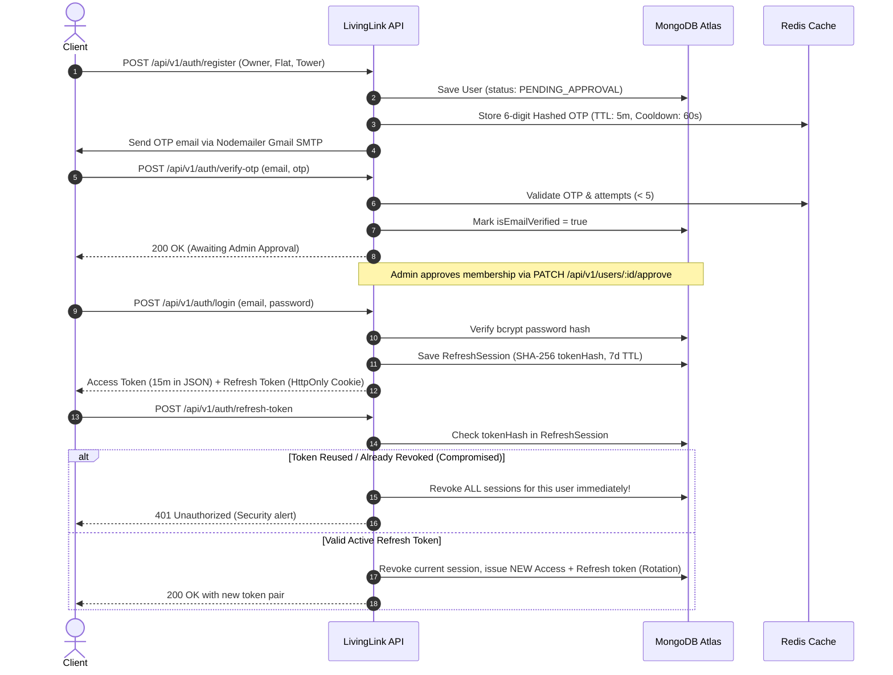
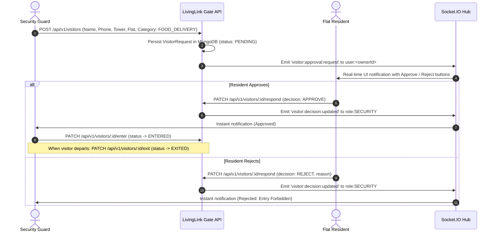

# LivingLink — Advanced Society Management System (Backend)

[](https://nodejs.org/)
[](https://expressjs.com/)
[](https://www.mongodb.com/)
[](https://upstash.com/)
[](https://socket.io/)
[](http://localhost:5000/api/v1/docs)

**LivingLink** is an enterprise-grade, modular, secure backend for a modern residential society management platform. It powers complete operations across resident authentication, society communication feed, notice management, digital amenity access cards with tamper-resistant QR tokens, maintenance billing with PDF receipts, gate management & visitor approvals, emergency SOS alerts, and consolidated committee analytics.

---

## 1. Architecture & Design Principles

LivingLink is built using a **Modular Monolith** architecture with strict separation of responsibilities:

- **Thin Controllers**: Handle HTTP requests/responses, status codes, and input extraction.
- **Service Layer**: Pure business logic, database queries, and transaction state management.
- **Schema & Model Layer**: Mongoose validation, compound indexes, references, and methods.
- **Input Validation**: Strict request schema enforcement via Zod for `body`, `query`, and `params`.
- **Centralized Error Handling**: Custom `AppError` class, operational error boundary, and structured logger.
- **Cache-Aside Architecture**: Redis for high-frequency queries, dashboard summaries, rate limiting, and OTP TTLs with graceful in-memory fallback.
- **Real-Time Communication**: Authenticated Socket.IO with strict room-based routing (`user:<id>`, `role:ADMIN`, `role:SECURITY`, `society:feed`).

```
backend/
├── src/
│   ├── app.js                   # Express application setup & middleware stack
│   ├── server.js                # HTTP server & Socket.IO initialization with graceful shutdown
│   ├── config/                  # Environment, DB, Redis, Email, Cloudinary & Logger configs
│   ├── constants/               # Roles, Statuses, Messages, and Cache Key namespaces
│   ├── models/                  # 15 isolated Mongoose schemas with compound indexes
│   ├── routes/                  # Express routers mounted under /api/v1
│   ├── controllers/             # Thin HTTP route handlers
│   ├── services/                # Core business logic and database interactions
│   ├── middlewares/             # JWT auth, strict RBAC, rate-limiters, error handling, audit
│   ├── validators/              # Zod input validation schemas
│   ├── sockets/                 # Authenticated Socket.IO rooms and event dispatchers
│   ├── utils/                   # QR token signing, PDF receipt generator, crypto, OTP, pagination
│   └── docs/                    # OpenAPI / Swagger specification
├── scripts/
│   ├── bootstrapAdmin.js        # Idempotent committee admin initialization
│   └── seedAmenities.js         # Amenity catalog & subscription plan seeder
├── tests/                       # Automated Jest & Supertest integration suite
├── .env.example
├── .gitignore
├── package.json
└── README.md
```

---

## 2. User Roles & Permission Matrix (Strict RBAC)

There are exactly three primary roles in LivingLink:

| Capability | OWNER | ADMIN | SECURITY |
| :--- | :---: | :---: | :---: |
| Register via Public Portal | Yes (Starts as `PENDING_APPROVAL`) | No (Bootstrap / Admin created) | No (Admin created only) |
| Tower & Flat Association | **Mandatory** | **Forbidden** (Null) | **Forbidden** (Null) |
| View Published Notices | Yes | Yes | Yes |
| Publish / Pin / Edit Notices | No | Yes | No |
| Common Society Feed | Send, Edit Own, Report | Send, Moderate / Delete Any | Send, Participate |
| Purchase Amenity Subscription | Yes (Demo simulation) | No | No |
| Digital Amenity Access Card | Yes (View own QR card) | Override with audit reason | Scan / Verify QR tokens |
| View Maintenance Bills | View own flat invoices | View & manage all society bills | Check eligibility only |
| Pay Maintenance Invoices | Yes (Demo simulation) | Record waivers / adjustments | No |
| Submit Complaints | Yes | Assign, update, resolve | **Forbidden** (No access) |
| Visitor Entry Workflow | Approve / Reject visitors | Emergency override | Create gate requests, log entry/exit |
| Emergency SOS Alerts | Trigger | View all, resolve | Acknowledge, respond |
| Society Analytics Dashboard | No | Full Access | Gate activity history only |

---

## 3. Core Operational Workflows

### 3.1. Authentication, JWT & Refresh Token Rotation



### 3.2. Digital Amenity Access Card & Society Eligibility Rule

Every owner receives a tamper-resistant digital access card:

- **GREEN Card**:
  1. The amenity subscription is currently active (`startDate <= now <= endDate`).
  2. The flat has **ZERO unpaid or overdue maintenance invoices**.
- **RED Card**:
  - Subscription does not exist or has expired.
  - OR the resident has outstanding unpaid maintenance invoices.
- **Tamper-Resistant Signed QR Token**:
  - Token is generated with HMAC-SHA256 (`payload.signature`) containing subscription and user references.
  - Guard scans QR code -> calls `/api/v1/amenity-access/verify`.
  - Server verifies cryptographic signature, re-checks live database subscription and maintenance status.
  - Logs verification outcome into `AmenityEntryLog` (`ALLOWED` / `DENIED`).
- **Core Society Rule**: Unpaid maintenance blocks amenity access, but **never blocks a resident from entering their home flat**.
- **Admin Override**: Admin can grant emergency override with mandatory audit reason (`ADMIN_OVERRIDE`).

### 3.3. Gate Management & Visitor Approval Workflow



### 3.4. SOS Emergency System

1. Any authenticated role (Owner, Admin, Guard) triggers SOS via `POST /api/v1/sos/trigger`.
2. Redis duplicate-trigger protection prevents double taps within 10 seconds.
3. Record saved in MongoDB with triggering user info and flat location.
4. Socket.IO broadcasts immediately to `role:SECURITY` and `role:ADMIN` rooms.
5. Persistent notifications saved for late-login guards and admins.
6. Guard acknowledges (`PATCH /api/v1/sos/:id/acknowledge`) with dispatch notes.
7. Admin resolves (`PATCH /api/v1/sos/:id/resolve`) with resolution details.

---

## 4. Temporary Demo Payment Simulation Engine

- **Safety Switch**: Strictly disabled if `NODE_ENV === 'production'`.
- **Passphrase Verification**: Matches against `process.env.PAYMENT_DEMO_SECRET`.
- **Server Calculation**: The payable amount in paise is calculated strictly from the database invoice or amenity plan. Client-supplied amounts are never trusted.
- **Idempotency**: Repeated requests with the same `idempotencyKey` return the existing transaction without double charges.
- **Receipts with PDFKit**: Downloadable PDF receipts generated on demand via `GET /api/v1/receipts/:id/download` with resident details, amounts, date, and simulation disclaimer.

---

## 5. Technology Stack

- **Runtime**: Node.js v22 LTS (Pure JavaScript)
- **Framework**: Express.js
- **Database**: MongoDB Atlas with Mongoose 8.x
- **Cache & Rate Limiting**: Upstash-compatible Redis via `ioredis` with TLS (`rediss://`) and resilient fallback
- **Real-Time**: Socket.IO 4.x
- **Security**: Helmet, CORS, Cookie-Parser, bcryptjs, HMAC-SHA256
- **Validation**: Zod 3.x
- **Logging**: Pino 9.x structured logging with sensitive field redaction
- **Receipts**: PDFKit
- **Documentation**: Swagger UI Express / OpenAPI 3.0
- **Testing**: Jest, Supertest, MongoDB Memory Server

---

## 6. Getting Started (Windows PowerShell)

### Prerequisites
- Node.js v20+ LTS installed (`node -v`)
- npm 10+ installed (`npm -v`)
- MongoDB Atlas connection string (or local MongoDB)
- Upstash Redis URL (or local Redis)

### Installation & Environment Setup

```powershell
# Navigate into backend directory
cd D:\project\LivingLink\backend

# Install dependencies
npm install

# Copy example environment configuration
Copy-Item .env.example .env
```

### Environment Variables (.env)

```env
NODE_ENV=development
PORT=5000

MONGODB_URI=mongodb+srv://<username>:<password>@cluster.mongodb.net/livinglink?retryWrites=true&w=majority
REDIS_URL=rediss://default:<password>@<endpoint>.upstash.io:6379

JWT_ACCESS_SECRET=your_32_character_long_super_secret_access_jwt_key!
JWT_REFRESH_SECRET=your_32_character_long_super_secret_refresh_jwt_key!
JWT_ACCESS_EXPIRES_IN=15m
JWT_REFRESH_EXPIRES_IN=7d

EMAIL_HOST=smtp.gmail.com
EMAIL_PORT=587
EMAIL_SECURE=false
EMAIL_USER=your_email@gmail.com
EMAIL_APP_PASSWORD=your_gmail_16_digit_app_password
EMAIL_FROM="LivingLink Society" <no-reply@livinglink.local>

FRONTEND_URL=http://localhost:3000
CORS_ORIGINS=http://localhost:3000,http://127.0.0.1:3000

PAYMENT_DEMO_SECRET=LivingLinkDemoPay2026!
DEMO_PAYMENTS_ENABLED=true

ADMIN_BOOTSTRAP_EMAIL=admin@livinglink.society
ADMIN_BOOTSTRAP_PASSWORD=AdminSecurePass#2026
ADMIN_BOOTSTRAP_NAME=Super Admin
ADMIN_BOOTSTRAP_PHONE=+919876543210
```

### Database Seeding & Bootstrap Scripts

```powershell
# 1. Bootstrap initial committee administrator account
npm run bootstrap-admin

# 2. Seed initial amenities (Gym & Games Room) with standard subscription plans
npm run seed
```

### Running the Application

```powershell
# Run in development mode (with auto-reload)
npm run dev

# Run in production mode
npm start
```

Server starts at: `http://localhost:5000`  
Interactive Swagger API Docs: `http://localhost:5000/api/v1/docs`  
Health Check: `http://localhost:5000/api/v1/health`

### Running the Automated Test Suite

```powershell
npm test
```

---

## 7. REST API Endpoints Overview

All routes are versioned under `/api/v1`:

### Health & Docs
- `GET /api/v1/health` — System, MongoDB, and Redis health status
- `GET /api/v1/docs` — Swagger UI API explorer

### Authentication (`/api/v1/auth`)
- `POST /register` — Register owner flat account (Public)
- `POST /verify-otp` — Verify registration OTP
- `POST /resend-otp` — Resend verification OTP (60s cooldown)
- `POST /login` — Login & receive JWT access + refresh token
- `POST /refresh-token` — Rotate refresh tokens with reuse detection
- `POST /logout` — Revoke active refresh session
- `POST /logout-all` — Revoke all sessions across devices
- `POST /forgot-password` — Trigger password reset OTP
- `POST /reset-password` — Reset password using OTP
- `GET /me` — Current authenticated user profile

### User & Staff Management (`/api/v1/users`)
- `POST /staff` — Admin creates ADMIN or SECURITY staff
- `PATCH /:id/approve` — Admin approves owner membership
- `PATCH /:id/status` — Admin updates status (`ACTIVE`, `SUSPENDED`, `DEACTIVATED`)
- `GET /` — List society users (Admin)
- `GET /flats` — List society flats & residents

### Notices (`/api/v1/notices`)
- `GET /` — View published notices (Cached in Redis)
- `POST /:id/read` — Record readership
- `POST /` — Create notice (`URGENT`, `IMPORTANT`, `GENERAL`) (Admin)
- `PATCH /:id` — Update notice / pin / expire (Admin)
- `DELETE /:id` — Delete notice (Admin)
- `GET /:id/readers` — View readership tracking (Admin)

### Society Feed (`/api/v1/feed`)
- `GET /` — Paginated message history (Owners, Admins, Guards)
- `POST /` — Send message (Broadcasts to `society:feed` room)
- `PATCH /:id` — Edit own message
- `DELETE /:id` — Delete own message or moderate as Admin
- `POST /:id/report` — Report inappropriate message

### Amenities & Subscriptions (`/api/v1/amenities`, `/api/v1/subscriptions`, `/api/v1/amenity-access`)
- `GET /amenities` — Catalog of amenities & subscription plans (Cached)
- `POST /subscriptions/purchase` — Owner purchases plan using demo payment
- `GET /amenity-access/cards/:amenityId` — View digital card (`GREEN` / `RED`) & signed QR token
- `POST /amenity-access/verify` — Guard scans QR token and validates eligibility
- `POST /amenity-access/override` — Admin emergency override with reason
- `GET /amenity-access/logs` — Amenity entry verification logs

### Maintenance & Payments (`/api/v1/maintenance`, `/api/v1/payments`, `/api/v1/receipts`)
- `GET /maintenance/my` — Owner views maintenance bills
- `POST /payments/pay-maintenance` — Owner pays invoice with demo secret
- `GET /receipts/:id/download` — Download PDFKit payment receipt
- `POST /maintenance` — Admin creates flat invoice
- `POST /maintenance/bulk` — Admin generates bulk invoices for tower/society
- `PATCH /maintenance/:id/waiver` — Admin records waiver/adjustment
- `GET /maintenance/admin/defaulters` — List maintenance defaulters

### Gate & Visitors (`/api/v1/visitors`, `/api/v1/gate`)
- `POST /visitors` — Guard creates visitor entry request
- `GET /visitors/my` — Resident views pending visitors for their flat
- `PATCH /visitors/:id/respond` — Resident approves or rejects visitor
- `PATCH /visitors/:id/enter` — Guard marks approved visitor as ENTERED
- `PATCH /visitors/:id/exit` — Guard marks visitor as EXITED
- `GET /visitors` — Gate logs and history

### Emergency SOS (`/api/v1/sos`)
- `POST /sos/trigger` — Trigger emergency alert (All authenticated roles)
- `GET /sos/active` — View active emergency alerts (Guard & Admin)
- `PATCH /sos/:id/acknowledge` — Guard acknowledges emergency
- `PATCH /sos/:id/resolve` — Admin resolves alert with notes
- `GET /sos/history` — Complete SOS incident history

### Committee Analytics (`/api/v1/analytics`)
- `GET /dashboard` — Consolidated analytics dashboard (Cached in Redis)
- `GET /society` — Flat and resident counts
- `GET /maintenance` — Billed vs collected, monthly collection, defaulters
- `GET /amenities` — Active subscriptions & revenue by amenity/plan
- `GET /complaints` — Status, category, and priority distributions
- `GET /gate` — Daily visitor counts and inside breakdown
- `GET /sos` — Active count and average emergency response times

---

## 8. Deployment Readiness (Render / Heroku / Cloud)

LivingLink is fully configured for zero-downtime deployment:
- Dynamic port binding via `process.env.PORT`.
- Redis TLS connection support via `rediss://` protocol for Upstash Redis.
- Process handlers for `SIGTERM` and `SIGINT` ensuring clean teardown of HTTP connections, Redis, and MongoDB.
- Production error masks preventing exposure of database errors, stack traces, or credentials.
- Automatic refusal of `DEMO_PAYMENTS_ENABLED` in `production`.
